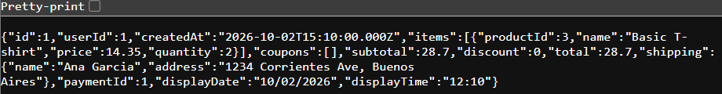

# Bugs found

Copy the block below for each bug. Sort them by priority (most important first).

---

## BUG-01 — Unauthorized access to another customer's order details

- **Source:** Found by me
- **Type:** Security - Broken Object Level Authorization
- **Severity:** High
- **Priority:** P1 — Unauthorized disclosure of customer order information represents a significant privacy and security risk.
- **Preconditions:** Fresh application dataset. Ana owns order #1. Bruno has a valid account.
- **Steps to reproduce:**
  1. Log in as Ana and verify that order #1 belongs to her.
  2. Log out.
  3. Log in as Bruno using bruno@shopnow.test.
  4. Navigate to http://localhost:4321/api/orders/1.
  5. Inspect the response and returned order information.
- **Expected result:** Bruno should not be able to retrieve Ana's order information. The API should return an appropriate authorization error, such as HTTP 403 or 404.
- **Actual result:** Bruno can retrieve order information belonging to Ana.
- **Evidence:** 
- **Automated test:** `tests/security.spec.ts`
- **Business impact:** Authenticated customers may access order information belonging to other customers by changing the order identifier.
- **Root cause in the code (optional):** Not investigated.

## BUG-02 — Applying a valid discount coupon does not update the cart total

- **Source:** User report 2
- **Type:** Logic
- **Severity:** High
- **Priority:** P1 — Incorrect discount calculations can result in customers paying more than expected and reduce confidence in the checkout process.
- **Preconditions:** Empty cart and a valid FLOCK10 coupon providing a 10% discount.
- **Steps to reproduce:**
  1. Open the Ceramic mug product detail page.
  2. Select a quantity of two.
  3. Add the products to the cart.
  4. Open the cart and verify the subtotal is $16.70.
  5. Enter the coupon code FLOCK10.
  6. Apply the coupon.
  7. Observe the updated cart total.
- **Expected result:** The coupon is accepted and the cart total is reduced to $15.03.
- **Actual result:** The coupon is accepted, but the cart total remains $16.70.
- **Evidence:** Playwright regression test output.
- **Automated test:** `tests/coupons.spec.ts`
- **Root cause in the code (optional):** Not investigated.

## BUG-03 — Cart items are lost after refreshing the page

- **Source:** User report 3
- **Type:** Data / Logic
- **Severity:** Medium
- **Priority:** P2 — Customers may lose selected products and need to reconstruct their shopping carts.
- **Preconditions:** Empty shopping cart.
- **Steps to reproduce:**
  1. Open product #1.
  2. Select a quantity of two and add it to the cart.
  3. Open product #2.
  4. Select a quantity of one and add it to the cart.
  5. Open the cart and verify both products are displayed.
  6. Refresh the page.
  7. Inspect the cart contents.
- **Expected result:** Both products and their selected quantities remain in the cart after refreshing.
- **Actual result:** No product remains in the cart after refreshing.
- **Evidence:** Playwright regression test output.
- **Automated test:** `tests/cart.spec.ts`
- **Root cause in the code (optional):** Not investigated.