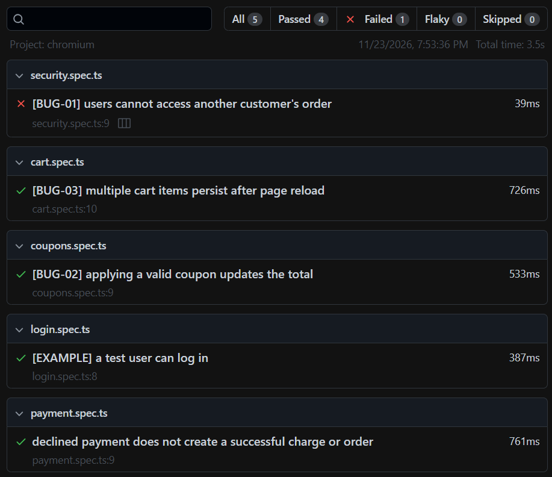

# AI usage

## Tools and models

- ChatGPT: Requirements analysis, risk-based testing strategy, exploratory testing guidance, documentation assistance.
- Copilot: Playwright test review, environment troubleshooting, debugging and code assistance.

## What I delegated to AI

- Reviewing the functional specification and identifying missing acceptance criteria, ambiguities and some questions for the Product Owner.
- Suggesting high-risk testing scenarios based on financial impact, customer privacy and core e-commerce functionality.
- Developing an exploratory testing strategy for the three customer-reported issues.
- Identifying additional security scenarios.
- Assisting with defect classification, severity, priority and reproducible bug report documentation.
- Reviewing the final deliverables against the challenge requirements.

## What I verified and how

- Playwright test implementations using the existing project dependencies and helper functions.
- Reviewed the supplied functional specification, API documentation, user reports and existing Playwright tests.
- Explored the application manually using both Ana's and Bruno's accounts.
- Inspected the product catalog, cart, authentication flow, order history and payment history.
- Verified the ownership of sample orders displayed for the two test accounts.
- Confirmed that Bruno could retrieve order information belonging to Ana through the documented order details API endpoint.
- Executed the Playwright test suite locally using Chromium.
- The initial successful test execution completed four tests in 9.4 seconds, with two passing and two failing.
- The existing login smoke test passed, confirming that the testing environment was operational.
- The initial single-product cart persistence test passed and did not reproduce the reported issue.
- Reviewed the initial automation results to identify scenarios requiring further investigation and improvements.
- Compared generated test implementations against the challenge requirements, including clean-state execution, documented API usage, data-testid selectors and bug identifiers.

## What I discarded or corrected from the output, and why

- AI-generated defect suggestions were treated as hypotheses rather than automatically classified as confirmed bugs. Actual application behavior was required to support defect reporting.
- The initial security test expected HTTP 404 specifically. This was identified as unnecessarily restrictive because HTTP 403 could also represent valid authorization enforcement.
- The initial coupon test used a product price that introduced ambiguity in monetary rounding. A quantity of two was proposed to produce an unambiguous expected discount calculation.
- The initial cart persistence test covered only one product. Because the test passed, the scenario was expanded to include multiple products.
- Generic UI selector placeholders in the initial AI-generated examples required adaptation to the actual application.
- Initial npm and Playwright commands were executed from the parent directory instead of the project directory. The working directory was corrected before successfully executing the test suite.
- Optional source code fixes and root cause investigation were deprioritized in favor of the mandatory QA deliverables.
- A failed automated test was not considered sufficient evidence of a product defect without evaluating its failure reason.

## Evidence

[ANALYSIS.md](shopnow-qa-challenge\ANALYSIS.md)
[BUGS.md](shopnow-qa-challenge\BUGS.md)
[tests](shopnow-qa-challenge\tests)

